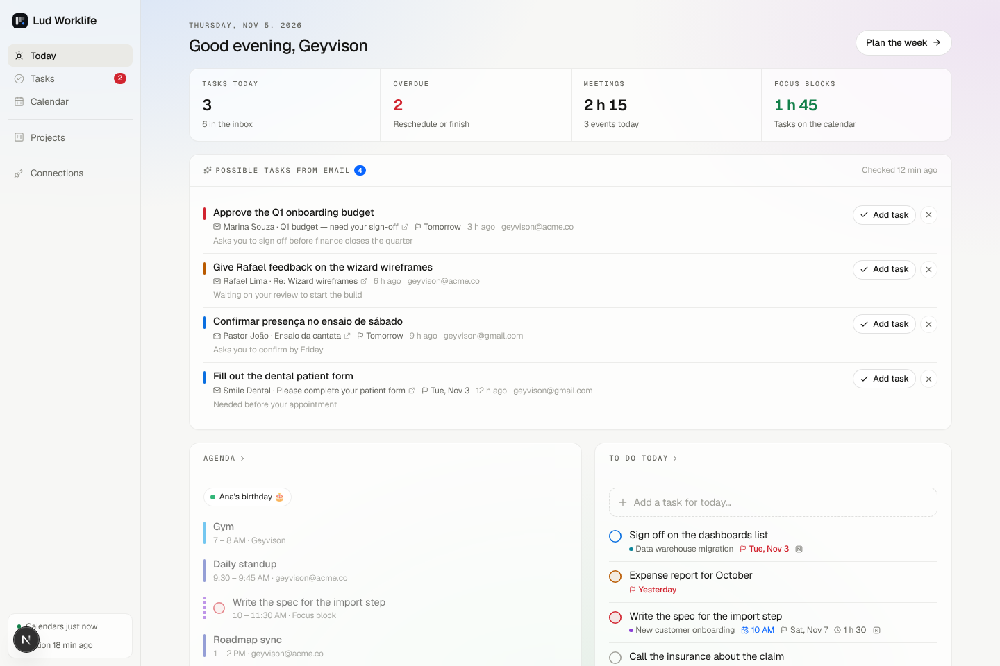
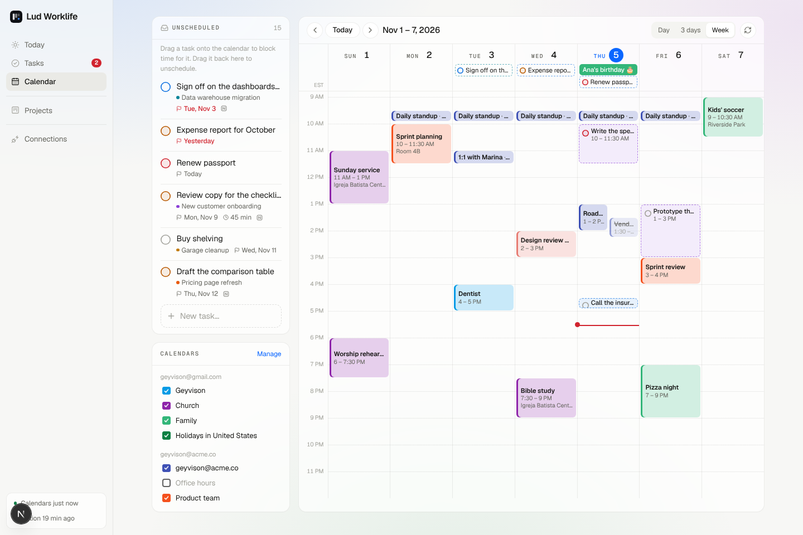
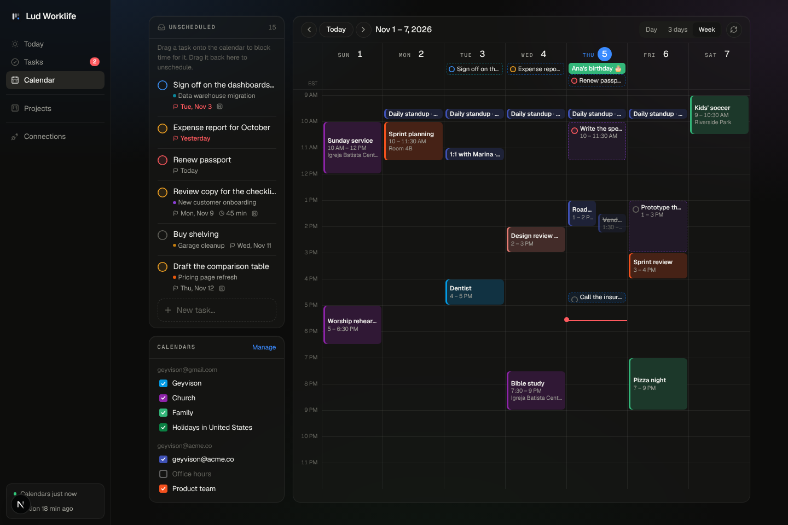
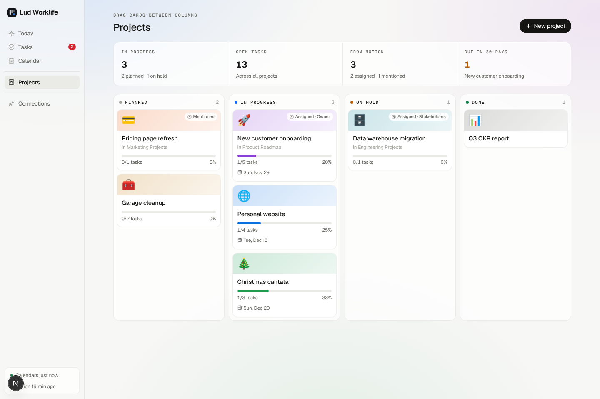
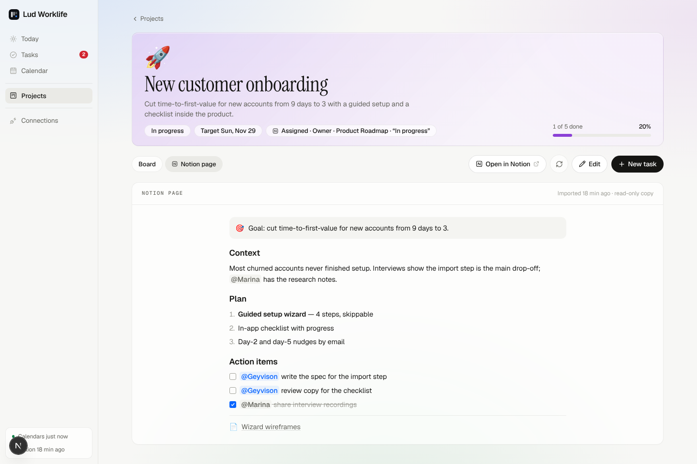

# Lud Worklife

A personal productivity dashboard — the sister app of **Lud Finances**, with the same look — for **projects, tasks and
calendars**:

- **Projects** as a **Kanban** board (Planned · In progress · On hold · Done), each with its own task board
  (Backlog · To do · In progress · Done). Drag cards between columns.
- **Tasks** you create anywhere (quick add understands `today`, `tomorrow`, `2026-12-01`, `!high`, `45m`, `1.5h`) and
  **drag onto the calendar** to block time — move the block, stretch it from its bottom edge, or drag it back to unschedule.
- **Calendar** with **any number of Google accounts** (personal, work, church…). Every calendar shows **the color it has in
  Google**; scheduled tasks can also be written to a Google calendar of your choice.
- **Notion**: pages in your company workspace where you're **@mentioned** or listed in a **People** property (Owner,
  Assignee, Team…) are **imported automatically** as projects, with a read-only copy of the page. To-dos that @mention you
  become tasks, and the page's status ("In progress", "Em andamento", "Done"…) places the card on the board.

- **Possible tasks from email** on Today: new inbox mail in every connected Google account is read (never changed);
  newsletters, marketing and automated mail are dropped, and **Claude** picks out what actually asks something of you —
  "Approve the Q1 budget", "Confirmar presença no ensaio de sábado" — with a due date when the email gives one. **Add task**
  turns it into a task with a link back to the thread; **×** dismisses it.

- **Habits:** add the habits you want to build, each with a goal (every day, or N× a week). Today opens with the day's
  checklist; on every other page it floats in the corner and can be minimized. **Habits** shows each one's streak, best
  streak, last-30-days rate and heatmap; each habit has its own evolution page (12-month heatmap where you can tick a day
  you forgot, week-by-week bars). Archive keeps the history; delete removes it.
- **Bible in a year (NIV):** all 1,189 chapters in 365 days — an Old Testament reading plus the New Testament with the
  Psalms woven in (about three chapters a day). Today shows the day's passages with **Read in NIV** (BibleGateway — the NIV
  text is copyrighted, so it isn't copied into the app), **Study notes** and **Mark as read**. The **Bible** page puts each
  day's passages and book introductions beside study notes for every chapter (summary, context, outline, key verses,
  cross-references and a thought for the day) written by Claude the first time a chapter is opened and kept after that;
  the scheduled sync prepares today's and tomorrow's ahead of time. A year map shows days read and days to catch up.
- **Daily stoic thought and Bible verse** at the bottom of Today (Marcus Aurelius, Seneca, Epictetus; verses on strength
  and focus from the KJV). Same pick all day on every device, a new one tomorrow; **shuffle** shows another, **♥** keeps it
  in **Saved** (`/saved`, filter by stoic or verses, copy or remove).



## Screens

| Screen | What it shows |
|---|---|
| **Today** | Tasks due, overdue, meeting time and focus blocks; today's agenda (events + time-blocked tasks, with a "now" line and Join buttons); today's tasks and inbox; projects in progress; latest pages from Notion |
| **Tasks** | List (Overdue · Today · Upcoming · Inbox · Done) or Board view, filtered by project |
| **Calendar** | Day / 3-day / week grid. Unscheduled tasks on the side — drag them in. Due-but-unscheduled tasks appear in the all-day row. Click an empty slot to create a task there; click an event for details, Meet link and "Open in Google Calendar". Show/hide each calendar |
| **Projects** | Kanban of projects by stage, with progress, target date and where it came from in Notion |
| **Project** | Cover, progress, the project's task board, and the **Notion page** tab |
| **Habits** | Your habits with streaks, 30-day rate and heatmaps; add, edit, archive or delete; each opens its own evolution page |
| **Bible** | Bible-in-a-year plan (NIV): today's passages, book intros and chapter study notes side by side, year map, catch-up |
| **Saved** | The stoic thoughts and verses you hearted on Today |
| **Connections** | Google accounts and their calendars (visibility, color), Notion workspaces, and scheduling preferences |



<details><summary>Dark mode</summary>



</details>





## Run it

```bash
npm install
npm run setup      # once: .env, built-in PostgreSQL (.pgdata/, port 5433), migrations, demo data
npm run dev        # → http://localhost:3000
```

The demo data has two Google accounts (in demo mode, nothing is called), a Notion workspace and a week of events, so every
screen works without any keys.

## Connect your accounts

### Google Calendar (as many accounts as you want)

1. In [Google Cloud Console](https://console.cloud.google.com) create a project, **enable the Google Calendar API**, and set up
   the OAuth consent screen (External, add your accounts as test users — or publish it).
2. Create an **OAuth client ID** (Web application) with these redirect URIs:
   - `<APP_URL>/api/google/callback` — connect calendars
   - `<APP_URL>/api/auth/google/callback` — sign in (optional)
3. Put `GOOGLE_CLIENT_ID` / `GOOGLE_CLIENT_SECRET` in `.env`, open **Connections → Connect Google Calendar**, and repeat
   **Add another Google account** for each account.

Colors: the Calendar API still reports colors from Google's old palette (e.g. `#9fe1e7`); the app maps them to what Google
Calendar shows today (Peacock `#039be5`, Sage, Tomato, Lavender…). Custom colors pass through. You can override a color
here without touching Google.

Scheduled tasks: in **Connections → Scheduling → Add scheduled tasks to**, pick one of your calendars. Dropping a task on the
calendar then creates an event there (marked with the task id, so it isn't shown twice); moving, resizing, unscheduling or
deleting the task updates the event.

### Possible tasks from email (Gmail)

Connecting a Google account also asks for **read-only Gmail** access (enable the **Gmail API** in the same Google Cloud
project). Accounts connected before this feature show **Allow Gmail** in Connections. Each scan (when Today opens, if the
last one is older than 15 minutes, on **↻**, and on the scheduled sync) reads up to 40 new inbox emails per account:

1. **Skipped without reading further:** Promotions / Social / Forums tabs, anything with `List-Unsubscribe`/`List-Id`, bulk
   precedence, marketing-platform headers, `no-reply`/`newsletter`/`notifications` senders, auto-replies, unsubscribe
   footers, and your own mail.
2. **The rest goes to Claude** (`claude-opus-5-5`, low effort, structured output) with today's date, in batches of 12. Only
   the new part of each message is sent (quoted replies are cut), at most 4,000 characters. Email text is treated as data —
   the prompt tells Claude to ignore instructions inside emails. Set `ANTHROPIC_API_KEY`; without it, conservative
   keyword rules (English and Portuguese: "can you…", "please…", "pode…?", "por favor", "até sexta") are used instead.
3. Every analyzed email is remembered, so nothing is read twice or suggested again after you dismiss it. Turn an inbox off
   with **Find possible tasks in this inbox** in Connections.

> Google treats Gmail read access as a *restricted* scope. For your own use, keep the OAuth app in **Testing** with your
> accounts as test users — but in Testing mode Google expires refresh tokens after **7 days**, so you'll see "Reconnect"
> weekly. To avoid that, publish the app (Google reviews apps using Gmail scopes) or use a Google Workspace "Internal" app
> for work accounts.

### Notion (your company workspace)

Two ways — the app only sees pages **shared with the integration**:

- **Public integration (OAuth):** create one at [notion.so/profile/integrations](https://www.notion.so/profile/integrations),
  redirect URI `<APP_URL>/api/notion/callback`, set `NOTION_CLIENT_ID` / `NOTION_CLIENT_SECRET`, then **Connect Notion** and
  choose the teamspaces/pages. Notion tells the app who you are.
- **Internal integration:** create one in the workspace (an admin may need to), turn on *Read user information including email
  addresses*, share the project pages or databases with it (••• → Connections), and paste the secret in **Connections**
  with the email you use in Notion.

On each sync the app looks at pages edited since the last one (the first sync looks back `NOTION_LOOKBACK_DAYS`, 90 by
default) and imports a page when **you are in a People property** ("Assigned · Owner") or **@mentioned** in its title,
properties or content ("Mentioned"). Already-imported pages are refreshed when they change. Dragging a Notion project to
another column here stops Notion's status from moving it back. Nothing is ever written to Notion.

### Sync schedule

- While the Calendar page is open it syncs Google if the last sync is older than 5 minutes; **Sync now** buttons everywhere.
- `GET /api/cron/sync` (with `Authorization: Bearer $CRON_SECRET`) syncs everything. `vercel.json` calls it daily (the Vercel
  free plan allows one cron a day) and `.github/workflows/sync.yml` calls it every 30 minutes (set the `APP_URL` and
  `CRON_SECRET` repository secrets). `npm run sync` does the same from a terminal.

## Deploy (Vercel + Neon) — separate from Lud Finances

Use **its own** Vercel project and **its own** Neon project (never point it at the finance database — `db:seed` and the
migrations are different apps).

1. **Neon:** create a new project (e.g. `lud-worklife`). Either connect it from **Vercel → Project → Storage → Connect
   Database → Neon** (adds `DATABASE_URL`/`POSTGRES_URL` and the unpooled URL for you), or copy the **pooled** connection
   string into `DATABASE_URL` yourself — the build derives the direct URL by dropping `-pooler`. Accepted names:
   `DATABASE_URL`, `POSTGRES_PRISMA_URL`, `POSTGRES_URL` and `DATABASE_URL_UNPOOLED`, `POSTGRES_URL_NON_POOLING`.
2. **Vercel → Settings → Environment Variables** (Production and Preview): `SESSION_SECRET`, `ENCRYPTION_KEY`
   (`openssl rand -hex 32` each), `APP_URL` (`https://<your-project>.vercel.app`), `ALLOWED_EMAILS`, `APP_TIMEZONE`,
   `OWNER_NAME`, `GOOGLE_CLIENT_ID`/`GOOGLE_CLIENT_SECRET`, `ANTHROPIC_API_KEY`, `CRON_SECRET`, and the Notion keys if you use OAuth.
3. **Google Cloud:** add `<APP_URL>/api/google/callback` and `<APP_URL>/api/auth/google/callback` to the OAuth client's
   redirect URIs (a separate OAuth client from the finance app is cleanest).
4. **Production branch:** set it to `main` once the PR is merged (Vercel → Settings → Git).
5. Deploy. The build runs `prisma migrate deploy`; if no database variable is found it stops with a message saying what to set.

## Architecture

- **Next.js 15** (App Router, Server Components, Server Actions) + **Tailwind CSS 4** + **Prisma/PostgreSQL**; no Google or
  Notion SDKs — plain `fetch`.
- Drag and drop is native HTML5; moves are optimistic and roll back if saving fails.
- Dates are computed in `APP_TIMEZONE` (DST-safe), so the server (UTC) and the grid agree.

```
src/
  app/(app)/            pages: today, tasks, calendar, projects, projects/[id], connections
  app/api/              google (connect, callback), notion (connect, callback), auth/google (sign-in), cron/sync
  app/actions.ts        server actions (tasks, projects, kanban moves, scheduling, calendars, Notion, settings)
  components/           UI kit, Kanban, CalendarView, TaskSheet (editor + toasts), NotionContent, connections
  lib/dates.ts          time-zone math, formatting (tested)
  lib/calendar-layout.ts overlapping events side by side (tested)
  lib/kanban.ts         columns and fractional ordering (tested)
  lib/colors.ts         Google palette mapping, project colors (tested)
  lib/google.ts         Calendar OAuth/API + event mapping (tested); lib/google-sync.ts sync + task mirroring
  lib/notion.ts         mention/assignment detection, status → stage, page snapshot (tested); lib/notion-sync.ts import
  lib/tasks.ts          buckets, sorting, day summary, quick-add parsing (tested)
prisma/                 schema, migrations, demo data
```
